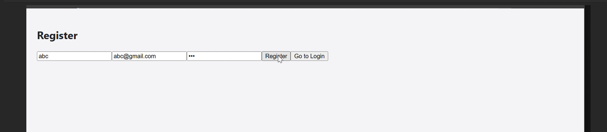
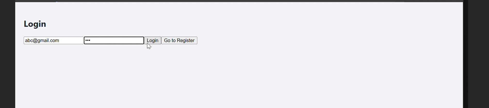
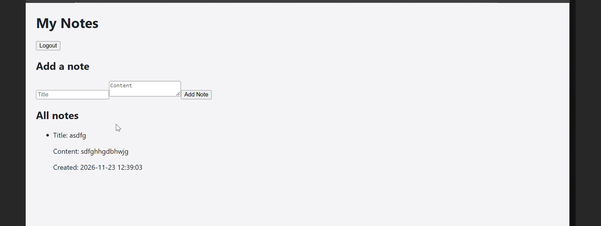
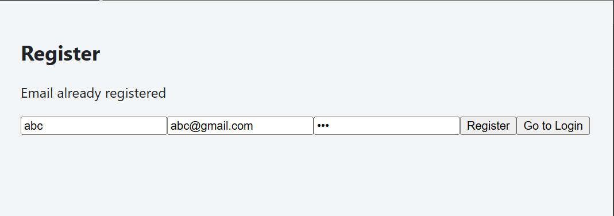
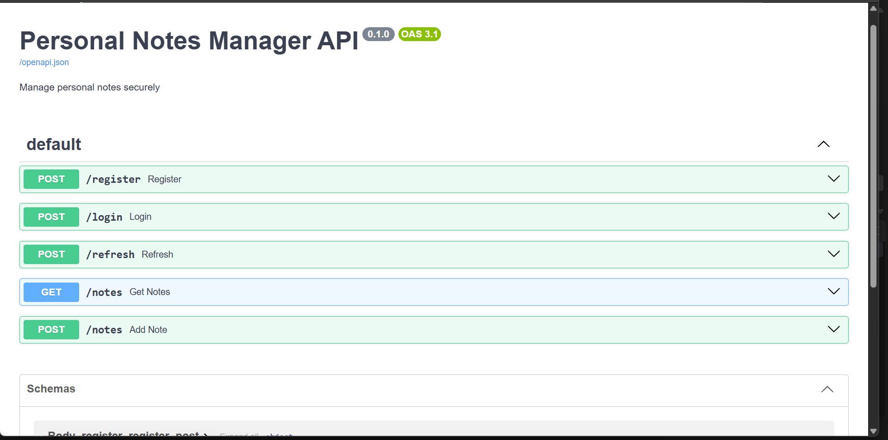
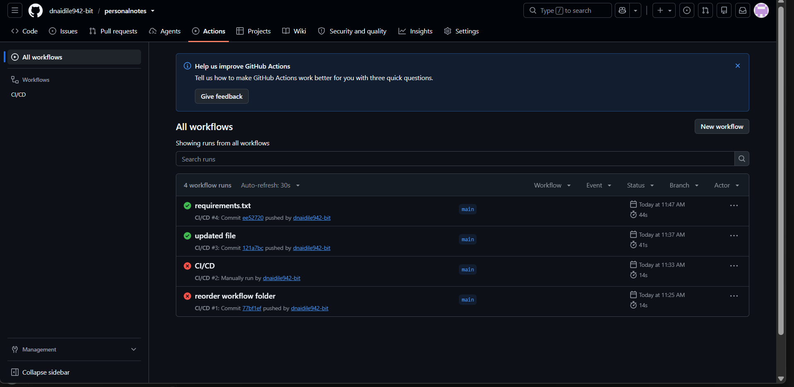

# Personal Notes Manager

## 1. Project and Team

**Project Name:** Personal Notes Manager

**Description:** A web application that allows users to register, log in, and securely manage their personal notes. Each user can access only their own notes.

**Team Members:**

| Member | Contribution |
|---|---|
| Sanghavi | A2, A3, E2 |
| naidile | A1, E1 |

## 2. Live Application

**EC2 Public URL:** [Add deployed application link]

## 3. How to Run the Project

### Backend

```bash
cd backend
python -m venv .venv
```

Windows:

```bash
.venv\Scripts\Activate
pip install -r requirements.txt
uvicorn main:app --reload
```

### Frontend

```bash
cd frontend
npm install
npm run dev
```

### Docker

```bash
docker build -t personal-notes .
docker run -p 8000:8000 personal-notes
```

## 4. API Contract

| ID | Method | Path | Request Body | Success Code |
|---|---|---|---|---|
| A1 | POST | `/register` | username, email, password | 200 |
| A2 | POST | `/login` | email, password | 200 |
| A3 | POST | `/refresh` | Refresh token in header | 200 |
| E1 | GET | `/notes` | Access token in header | 200 |
| E2 | POST | `/notes` | title, content | 200 |

### Error Rules

| Condition | Status Code |
|---|---|
| Duplicate email | 409 |
| Incorrect email or password | 401 |
| Invalid or expired access token | 401 |
| Invalid or expired refresh token | 401 |
| Accessing notes without authentication | 401 |
| Missing or empty required fields | 422 |
| Invalid email format | 422 |

## 5. Database

SQLite database: `notes.db`

**Users Table**

- id
- username
- email
- hashed_password
- created_at

**Notes Table**

- id
- user_id
- title
- content
- created_at

## 6. Screenshots

1. **Registration:** 
2. **Login:** 
3. **Notes Dashboard:** 
4. **Error Message:** 
5. **API Endpoint in Swagger UI:**
6. **Successful GitHub Actions Run:**

## 7. Known Issues and Future Improvements

Known Issues

The application requires an active backend server to function.
The application currently supports basic note creation and viewing.
Password recovery and email verification are not implemented.

Future Improvements

Add an option to edit and delete notes.
Add a search feature to find notes quickly.
Add password reset and email verification.
Improve the user interface and make it mobile-friendly.


